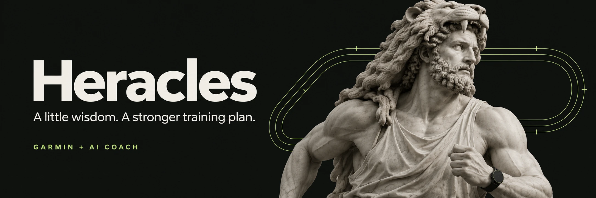

# Heracles

**佳明训练计划的 AI 增强教练。大力神也有恢复日。**

A self-hosted, mobile-first companion for your Garmin training plan. Go + React PWA + SQLite, with the official DeepSeek Harness.

佳明负责长期训练主线，Heracles 处理今天的变化。训练做完了想复盘，临时只有半小时，想加一堂间歇，或者周末突然想去骑车：和教练讨论，检查具体步骤与调整依据，再决定是否采用。

## 日常使用

- **训练后复盘**：结合实际活动、分段、心率与功率区间、原计划和自己的感受，分析执行与后续恢复。
- **临时改期、减量**：调整未来14天的具体课程；保留未受影响的安排，可继续修改，也可撤销回上一版。
- **加入专项训练**：跑步间歇、骑行、LSD、力量等一起考虑。运动类型可扩展，不另建一套长期主线。
- **每天记录恢复**：疲劳、疼痛、可用时间与备注，结合佳明睡眠、HRV、准备度、恢复等记录；区分测量时间、读取时间与缺失数据。
- **力量训练打卡和教学**：记录组数、次数、负重、用力感；内置12个动作的有许可图片、5段视频与1张动图，显示逐项出处。
- **手机优先**：今日、教练、计划三个入口；底部操作、动作抽屉、软键盘与安全区域适配，支持减少动态效果。HTTPS 下可安装 PWA。

个人自托管应用，不提供多人账户或社交。没有虚构训练数据；同步失败保留上次快照。

## 佳明计划能否修改？

**目前不能可靠直接修改 Garmin 自适应 Coach 计划。** 它的 UUID 课程与普通自定义课程不是同一套接口。已对中国区真实账号验证普通跑步、骑行、力量课程的创建、读取、更新和删除，但不能因此声称能改写自适应主线。

Heracles 调整先在本站生效。采用后，可再次明确确认，将支持的课程创建到**佳明课程库**，再由你在佳明选择和同步设备。不会自动改写自适应计划、排期或完成状态。撤销本站调整不删除已导出的独立课程。发送有持久回执和读回核实；结果不确定时阻止盲目重试。

详见 [能力核验与限制](docs/garmin-capabilities.md)。这是非官方 Garmin 接口，可能变化；中国区已验证，国际区未验证。设备需先上传到佳明云端，默认每5分钟同步，属于近实时轮询。

## Docker 启动

```sh
git clone https://github.com/hx-w/heracles.git
cd heracles
cp .env.example .env
# 在 .env 填写 DEEPSEEK_API_KEY
docker compose up -d --build
```

默认仅监听 `127.0.0.1:8791`，以非 root 用户运行，私人数据保存在 `heracles_data` 卷。运行镜像包含 Go 服务和官方独立 Harness 可执行文件，**没有 Python 解释器或兼容层**。构建阶段也直接校验并提取官方独立发布包，无需 Python。

生成一次性授权链接：

```sh
docker compose exec heracles heracles access --url http://localhost:8791
```

打开链接并点击“授权此设备”。链接24小时有效，只能绑定一次；GET 和链接预览不会消耗它。设备凭证只保存哈希，服务端授权不设到期时间；浏览器使用 HttpOnly cookie，HTTPS 下启用 Secure，并在日常使用时续期。清除网站数据、隐私模式、换浏览器或设备需要重新绑定。撤销所有授权：

```sh
docker compose exec heracles heracles access --revoke-all
```

### 导入佳明授权

使用自己已登录的 Garmin DI 凭证 JSON（含 `di_token`、`di_refresh_token`、`di_client_id`）。应用不要求在网页输入佳明密码；凭证到期自动刷新并原子保存。

```sh
docker compose cp /private/path/garmin_tokens.json heracles:/tmp/garmin-import.json
docker compose exec heracles heracles garmin-import --file /tmp/garmin-import.json
docker compose exec heracles rm /tmp/garmin-import.json
docker compose restart heracles
```

默认 `GARMIN_REGION=cn`。首次没有自己的 DI 凭证时需先完成 Garmin 客户端登录；本项目不包含密码登录或验证码绕过。不要提交凭证、数据库、访问链接或真实健康记录。

### HTTPS 与 PWA

可使用已有 HTTPS 反向代理或 Cloudflare Tunnel 转发到 `127.0.0.1:8791`，保留 Host 与协议头。也提供通用 Caddy 配置：

```sh
# .env 设置 HERACLES_DOMAIN，并将 DNS 指向服务器、开放80/443
docker compose -f compose.yaml -f compose.production.yaml up -d --build
docker compose exec heracles heracles access --url https://your-domain.example
```

iOS Safari 分享菜单选择“添加到主屏幕”；Android 使用浏览器安装。训练和聊天数据不进入 service worker 缓存，离线时显示重连页。

### 部署 CI 镜像

仓库仅一条 [Docker image CI](https://github.com/hx-w/heracles/actions/workflows/docker-image.yml)。PR 验证构建；main、版本标签和手动触发还产出 Linux amd64 镜像包。没有其他 CI。

下载 `heracles-linux-amd64` artifact 并解压：

```sh
docker load -i heracles-image.tar.gz
docker compose up -d --no-build
```

ARM 主机可从源码构建。升级前备份数据卷；回退时加载上一版镜像。不要用 `down -v` 升级，它会删除私人数据。

## 配置与开发

`COACH_MODEL`、`COACH_PROVIDER` 是运行配置，与教练提示词解耦。默认 `deepseek-flash`，对应 DeepSeek V4.1 Flash；官方 Harness 独立运行时固定为当前已验证发布版 `0.2.1rc2`。更换模型需验证结构化输出支持；更换提供方还需配置其 Harness 凭证。教练无法使用 shell、文件或工作目录工具，业务数据查询由 Go 校验执行。

本地需要 Go 1.25+、C 编译器（SQLite CGO）、Bun，以及官方 `dsh` 可执行文件。Docker 已包含这些运行依赖。

```sh
bun install --frozen-lockfile
bun --bun run build
# 导出 .env 中的服务器变量，并设置 HARNESS_BIN（若不在 PATH）
go run ./cmd/heracles
# 前端开发服务代理本地后端
bun run dev
```

验证：`go test -race ./...`、`bun --bun run build`。详见 [贡献指南](CONTRIBUTING.md)、[架构](docs/architecture.md)、[安全说明](SECURITY.md)、[动作素材许可](docs/exercise-media.md)。

## 致谢与许可

交互参考 [Moshi](https://getmoshi.app/)，动效参考 [React Bits](https://reactbits.dev/)，使用轻量自有实现；训练提案参考 [openGym](https://github.com/DuarteSantos8/openGym) 的显式确认和基线校验思路。教练由 [DeepSeek Harness](https://github.com/deepseek-ai/deepseek-harness) 驱动。动作资料来自 [wger](https://wger.de/)，按每项 Creative Commons 许可标注。

代码 [MIT](LICENSE)，动作数据和媒体遵循各自许可，不由 MIT 覆盖。横幅由 ImageGen 生成。Heracles 与 Garmin、DeepSeek 无官方关联。训练建议不是医疗诊断。
